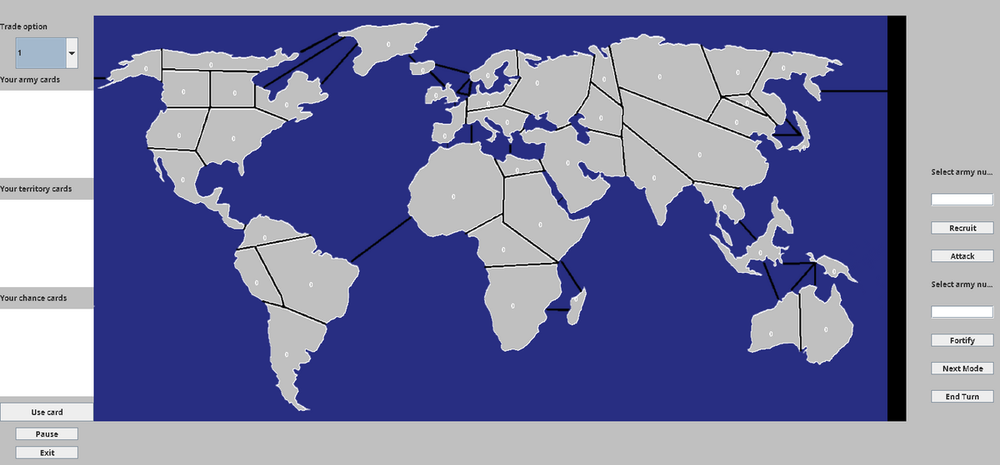

# CONKUEROR — turn-based strategy game (Java/Swing)

A Risk-inspired world-conquest game for 2–6 players, built by a four-person team for Koç University's COMP 302 (Software Engineering), spring 2023.



## What it does
- A world map of territories grouped into continents, with an adjacency graph between neighbouring territories.
- Turns move through three phases: recruit, attack and fortify.
- Battles are resolved with attacker and defender dice, and the attacker can occupy a territory after winning it.
- Three army types (infantry, cavalry, artillery), plus army, territory and chance cards and the trade-in options.
- Login and registration, game setup screen (player count, computer players, continents), pause and game-over screens.

## My part
I built most of the combat and territory logic, about 1,000 of the lines added on the main branch:
- `WarController`: attack flow, dice rolls, casualties, territory occupation.
- `TerritoryController`: the world map as a graph (territories, adjacency, continents).
- `Validator`: rule checks for army placement, attacks and moves.
- Army types, dice classes and the `Player` attack methods.
- Moving the nickname-entry UI logic into the controller layer, and the `rollSimpleDice()` test specification.

The team worked through GitHub issues and feature branches; 41 pull requests were merged.

## Design
- Layered structure: domain logic (`src/domain`) is separate from Swing views (`src/ui`).
- Controllers are singletons. Territories are `Observable`, and an `UpdateController` redraws the map when they change.
- Cards are created through a `CardFactory`, and card effects sit behind a `CardEffect` strategy interface.

## Run
Requires JDK 17 or later.

```bash
javac -d bin $(find src -name '*.java')
java -cp bin ui.Main
```

Run the game from the repository root so it can find the images. To start, register any username and password on the first screen.

## Limitations
This was a course project and was left unfinished in some areas:
- The computer player (`ComputerPlayer.calculateMove`) and the five chance-card effects are stubs.
- There is no save/load support for a game in progress.

## Team
- [@mgeckil18](https://github.com/mgeckil18) (Mehmet Furkan Geçkil)
- [@Liquiduck](https://github.com/Liquiduck)
- [@AlibayOsmanli](https://github.com/AlibayOsmanli)
- Ronas Yüce
